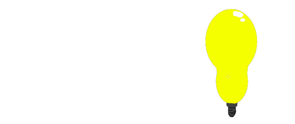

# bulb

<p align="center">
    
</p>

bulb is a small experimental programming language. its compiler is written in python and emits c; gcc can compile that c into a native program.

## what you need

- python 3 to run the compiler from source
- gcc to compile the generated c
- rust, installed with rustup, to run the three-language benchmarks

bulb is licensed under GPL-3.0-or-later; see [`LICENSE`](LICENSE).

## try it

```text
fn main() -> i64:
    let answer = 6 * 7
    return answer
```

the same program is in [`examples/answer.bulb`](examples/answer.bulb). compile it and run it:

```sh
python3 bulb.py examples/answer.bulb -o /tmp/answer.c
gcc -std=c11 -O2 /tmp/answer.c -o /tmp/answer
/tmp/answer
```

the program exits with status `42`.

## what works

- functions with `i64` or `bool` parameters and return values
- inferred local types, immutable `let` values, and mutable scalar `var` values updated with `set`
- arithmetic, comparisons, boolean operators, function calls, `if`/`else`, and `while`
- fixed-size arrays and structs stored inline; array access checks bounds

`i64` arithmetic wraps to 64 bits. division truncates toward zero, division by zero aborts, and `INT64_MIN / -1` returns `INT64_MIN`. locals must be declared at function scope. there are no pointers, heap allocation, mutable arrays or structs, or returns from inside loops yet.

## compare speed

the benchmark runs equivalent loop, recursive fibonacci, and array programs in bulb, c, and rust. it checks their full results, then reports the median of five runs:

```sh
python3 benchmarks/compare_c.py --workload sum
python3 benchmarks/compare_c.py --workload fib
python3 benchmarks/compare_c.py --workload array
```

use `--size N` to change the workload size. compilation is not timed; process startup and printing are. gcc uses `-O2 -march=native -flto`, and rustc uses `opt-level=2` with the native cpu. the compilers may optimize the same source differently: for example, rust can replace the sum loop with a formula. these numbers describe these programs on your machine, not the overall speed of bulb.

## tests

```sh
python3 -m unittest discover -s tests -v
```

## windows installer

version tags create a windows installer in the github release. it uses [`bulbicon.png`](bulbicon.png) in the setup wizard and embeds [`bulbicon.ico`](bulbicon.ico) in the installer and `bulb.exe`. it installs `bulb.exe` and the examples, and can add bulb to your user `PATH`. python is not needed after installation. bulb emits c; compiling that c into a native program still requires a windows c compiler such as gcc.

## arch linux

until bulb is available in the AUR, you can build the package from the github source:

```sh
git clone https://github.com/runewasneverhere/bulb-lang.git
cd bulb-lang/packaging/arch
makepkg -si
```

this needs `base-devel` and python. `makepkg -si` may ask for administrator approval to install missing dependencies. gcc is optional and is only needed to compile generated c.